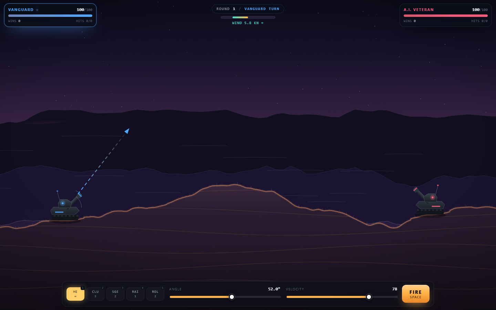
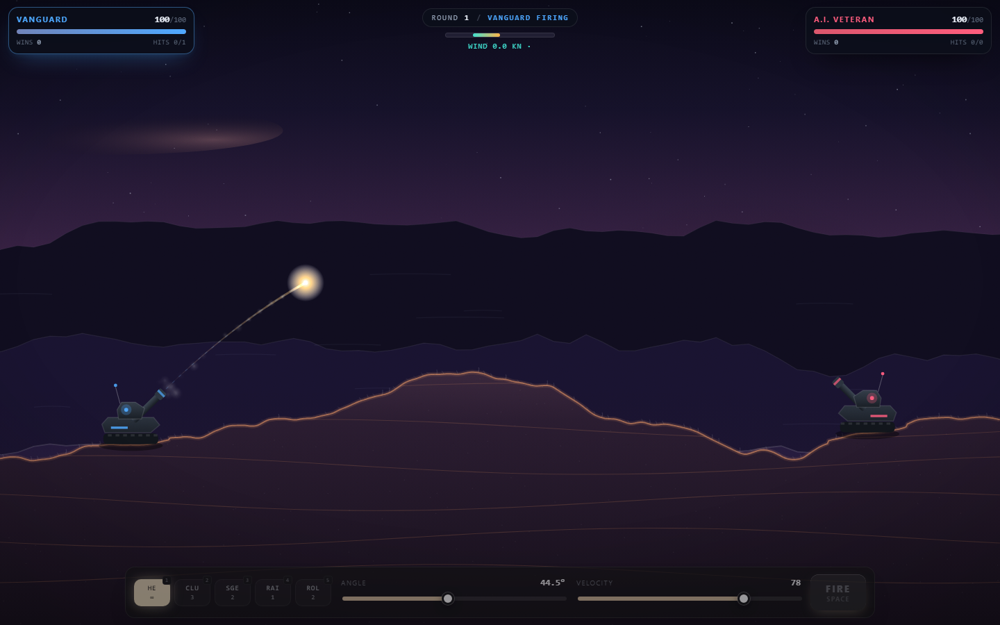
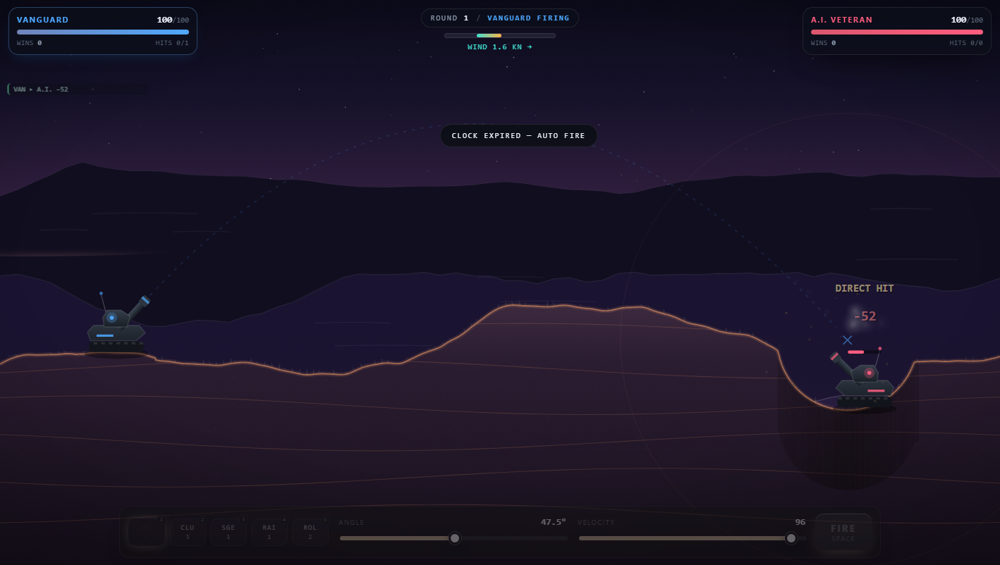
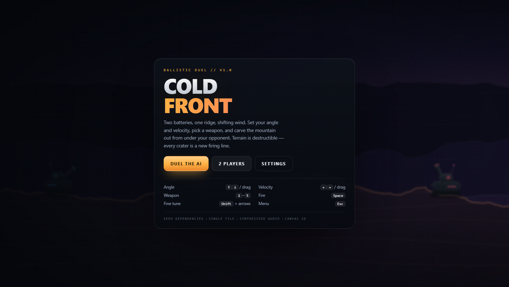

# COLD FRONT

**A modern artillery duel in a single HTML file.** Two batteries, one ridge, shifting wind. Set your angle and velocity, pick a weapon, and carve the mountain out from under your opponent — every crater is a new firing line.

**[▶ Play it](https://nwfella.github.io/cold-front/)**



---

## Why it's interesting

Most browser artillery games are Gorillas with a fresh coat of paint. This one treats the terrain as the primary system rather than a backdrop:

- **Destructible heightmap terrain.** The ground is a 1600-column surface array. Each shell bites a circle out of it, scorches the rim, and the dirt stays gone. Shoot out a ridge and your next shot has a line it didn't have before — or drop the ground under an enemy and let gravity bill them for it (fall damage).
- **Ballistics the AI actually understands.** The opponent solves the closed-form trajectory with wind, muzzle offset and terrain clearance, then degrades that answer by a per-difficulty error that shrinks as it learns your position. It lobs ridges instead of drilling them.
- **Five weapons with real trade-offs.** Flat-firing railgun (no gravity, no wind, one round), apex-splitting cluster, terrain-shaping siege shell, ground-hugging roller.
- **Zero dependencies.** No frameworks, no build tooling, no assets, no network requests. 99 KB of HTML including CSS, audio and art. The icon set is rendered from the same shapes the game draws.
- **Verified, not just written.** A zero-dependency Chrome DevTools Protocol gate drives the shipped file in a real browser: **43 checks** covering physics, AI behaviour, terrain destruction, weapon rules, layout at three viewports, and an unattended 6000-tick soak.

---

## Screenshots

| Aiming | Shell in flight |
|---|---|
|  |  |

| Impact + crater | Title |
|---|---|
|  |  |

---

## How to play

| Action | Desktop | Touch |
|---|---|---|
| Angle | `↑` `↓` (hold `Shift` for fine) | drag on the field, or the slider |
| Velocity | `←` `→` (hold `Shift` for fine) | drag distance, or the slider |
| Select weapon | `1`–`5` | weapon chips |
| Fire | `Space` / `Enter` | **FIRE** |
| Menu / settings | `Esc` | settings button |

Two modes: **duel the AI** (Recruit / Veteran / Elite) or **2 players** hotseat on one device.

After 10 turns the **Metal Storm** starts dropping meteors. It reshapes the field and hurts, but it is deliberately non-lethal: storm damage can take you down to 25 HP and no further, and rubble it knocks loose is floored for the same window. You can lose the round to your opponent, never to the weather.

Wind changes every turn and is shown in kN. Direct hits hurt; splash falls off with distance; a shell that catches your own ramp will hurt you too.

---

## Under the hood

### Terrain

`genTerrain(seed)` builds a `Float32Array` of surface heights from layered value noise plus an optional central ridge, then flattens a pad under each spawn. Everything downstream is a query against that array:

```js
function carve(cx, cy, r) {          // circular bite, then soften the rim
  for (let i = cx - r; i <= cx + r; i++) {
    const half = Math.sqrt(r * r - (i - cx) ** 2);
    if (cy + half > terrain[i]) terrain[i] = cy + half;
  }
}
```

Terrain is deterministic per seed, which is what makes the whole thing testable — the gate asserts same-seed ⇒ identical heightmap hash.

### The AI

`solveBallistic(shooter, target, wind, weapon)` sweeps 0.75° × 2-power candidates, solves each parabola for the time it crosses the target's height, and scores **range error + terrain clearance**:

```js
const disc = vy0 * vy0 - 2 * G * (y0 - ty);
const t = (-vy0 + Math.sqrt(disc)) / G;               // time to target height
const predX = x0 + vx0 * t + 0.5 * wind * t * t;      // where it actually lands
```

Three details that matter more than they look:

1. **Start at the muzzle, not the hull.** The barrel offset shifts a full-field shot by ~140 px — enough to miss completely.
2. **Score clearance in mid-flight only.** Including the descent (which ends at ground level by definition) makes every solution read as "blocked".
3. **Flat rounds are scored on vertical error**, because a projectile with no gravity reaches the target's *x* from any angle — "range error" is trivially zero and the AI would fire it into orbit.

Difficulty jitters the solved answer (±4.6° Elite → Recruit) and multiplies the error down each turn so a long round gets harder.

### Feel

Fixed 60 Hz logic step with an accumulator; render at whatever the display gives you. The camera pulls back to 0.9× and tracks the shell through its arc, then settles. Screen shake, muzzle flash, trails, soft-sprite smoke, shockwave rings, crater scorch, damage numbers, a shot log, and a five-palette time-of-day system that changes every round.

Audio is synthesised at runtime with WebAudio — brown-noise explosions through a swept lowpass, a filtered wind bed that rises with the gust, and a UI blip. No audio files.

---

## Project layout

```
index.html              # the artifact — everything inlined (99 KB)
build.sh                # concatenates src/js/*.js into src/shell.html
src/
  shell.html            # markup + design system (CSS)
  js/00-core.js         # constants, RNG, noise, palettes, weapons, state
  js/10-audio.js        # WebAudio synth engine
  js/20-world.js        # terrain generation/destruction, camera, view transform
  js/30-entities.js     # projectiles, explosions, particles, damage
  js/40-render.js       # sky, parallax ridges, terrain, units, FX
  js/50-game.js         # match/round state machine, ballistic AI
  js/60-ui.js           # HUD, overlays, pointer + keyboard input
  js/70-boot.js         # sizing, main loop, window.ART test hooks
  icon.svg              # icon source (rendered by scripts/icons.js)
scripts/
  gate.js               # headless Chrome CDP gate — 43 assertions
  probe.js              # one-expression CDP console for debugging
  icons.js              # renders the PNG icon set from icon.svg
shots/                  # screenshots captured by the gate
```

## Developing

```bash
sh build.sh          # inline src/ -> index.html, then node --check
node scripts/gate.js # boot it in headless Chrome, assert, screenshot, exit 0/1
node scripts/probe.js "ART.snapshot()"   # poke the live game from the CLI

# gate the DEPLOYED artifact, not the working copy
GATE_URL=https://nwfella.github.io/cold-front/ node scripts/gate.js
```

The game exposes a test surface in the shipped file — harmless in production and the reason the gate can be this blunt:

```js
ART.start('ai', 424242);   // deterministic seed
ART.setTurn(0); ART.setWind(0);
const s = ART.solve();     // closed-form solution at the current state
ART.aim(s.angle, s.power); ART.fire();
ART.settle();              // run the shot to resolution
ART.terrainHash();         // assert the crater
```

Sample assertions:

- `same seed → same terrain`, `different seed → different terrain`
- `every AI volley lands nearer the enemy than the shooter`, `AI never damages itself`
- `railgun is flat: vy and vx unchanged after 30 ticks`
- `cluster splits into ≥ 2 concurrent projectiles`
- `killing blow ends the round and credits a win`
- `command bar fits a 390×844 and an 844×390 viewport`
- `6000 ticks, zero page errors`

## License

MIT — see [LICENSE](LICENSE).
